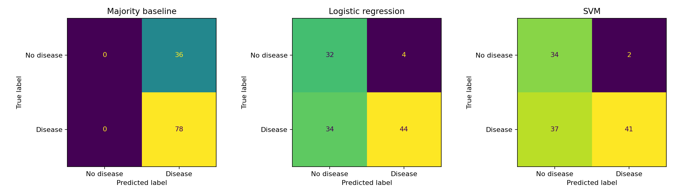

# Liver Disease Classification

A reproducible comparison of a majority-class baseline, logistic regression and an RBF support vector machine on the UCI Indian Liver Patient Dataset (ILPD).

This is a portfolio refresh of earlier machine-learning coursework. The current analysis uses an AI-assisted starter workflow. Execution, source data and evaluation outputs are documented; this is not a clinical diagnostic system.

## Research question

How do three predeclared classifiers compare when preprocessing and model selection use training data only, and a separate partition is reserved for final evaluation?

## Data

- Source: [UCI ILPD](https://archive.ics.uci.edu/dataset/225/ilpd).
- Citation: Ramana, B. and Venkateswarlu, N. ILPD (Indian Liver Patient Dataset). UCI Machine Learning Repository. DOI: [10.24432/C5D02C](https://doi.org/10.24432/C5D02C).
- Dataset licence: CC BY 4.0. This licence applies to the dataset, not automatically to software from other sources.
- Original data: 583 records and 10 input features, plus the target.
- Exact duplicate records removed: 13; records retained: 570.
- Four missing albumin-to-globulin ratios are handled by training-only median imputation.
- Training partition: 456 records; held-out partition: 114 records.
- Held-out composition: 78 records labelled as liver disease and 36 labelled as no liver disease.

Original `Selector=1` is mapped to disease-positive `1`; original `Selector=2` is mapped to `0`. The target is never included among the model inputs. Archive and CSV hashes are recorded in `results/data_provenance.json`.

## Analysis design

1. Remove exact duplicate rows and group identical feature rows to prevent their appearing in both training and test partitions.
2. Reserve the first fold of a shuffled, five-fold `StratifiedGroupKFold` split as the approximately 20% held-out partition, using seed 42.
3. Fit missing-value imputation, numerical standardization and gender encoding inside each training pipeline.
4. Compare one majority-baseline setting, six logistic-regression settings and eighteen RBF-SVM settings using three-fold grouped stratified cross-validation on training records.
5. Select the model using mean cross-validation balanced accuracy, then refit that model configuration on the training partition.
6. Evaluate all three predeclared model families on the held-out partition without changing the selected model based on test performance.

Identical-feature groups are a duplicate safeguard, not verified patient identifiers. No claim of confirmed patient-level independence is made. Cross-validation standard deviations describe variation between folds; they are not confidence intervals.

## Results from this execution

| Model | Training CV balanced accuracy | Held-out accuracy | Held-out balanced accuracy | Disease precision | Disease recall | ROC-AUC |
| --- | ---: | ---: | ---: | ---: | ---: | ---: |
| Majority baseline | 50.00% | 68.42% | 50.00% | 68.42% | 100.00% | 0.5000 |
| Logistic regression | 70.75% | 66.67% | 72.65% | 91.67% | 56.41% | 0.7817 |
| RBF SVM | 70.08% | 65.79% | 73.50% | 95.35% | 52.56% | 0.7867 |

**Logistic regression was selected by training cross-validation**, with `C=0.1` and `class_weight="balanced"`. The SVM's slightly higher held-out balanced accuracy does not change that predeclared selection. These small differences are not evidence of a statistically established ranking across populations.

For the selected model:

- 44 of 78 disease-labelled records were classified as positive; 34 were missed.
- 32 of 36 no-disease records were classified as negative; 4 were false positives.
- Precision of 91.67% means 44 of the 48 positive predictions were correct in this test partition. It does **not** mean 91.67% of disease-labelled records were detected.
- Balanced accuracy is the mean of disease recall (56.41%) and no-disease recall (88.89%), giving 72.65%.

The majority baseline predicts disease for every record. Its 68.42% ordinary accuracy and 100% disease recall conceal a 0% no-disease recall. Logistic regression improves balanced accuracy relative to that baseline, but does not improve ordinary accuracy. Its false-negative count remains substantial.



Full-precision results, predictions and model-selection details are in `results/test_metrics.csv`, `results/held_out_predictions.csv` and the cross-validation files.

## Reproducibility

This execution used Python 3.13.18. Exact package versions are recorded in `requirements.txt` and `results/environment.json`; seed and split assignments are also saved. Different library versions can change group assignments and model selection even when the numerical seed is unchanged. For comparison with this run, use its recorded environment and verify the saved split assignments.

Install the recorded dependencies, then run:

```bash
python -m pip install -r requirements.txt
python liver_disease_classification.py
```

Run in a separate working folder with internet access for the UCI download. The script creates `liver_disease_project/`. A CPU is sufficient. The executed Colab notebook can also be used; its outputs should remain associated with the environment that generated them.

The current script regenerates its template README inside the output folder. After the final reproducibility run, use this reviewed README and the completed `PERSONAL_CONTRIBUTION.md` as the repository documents. Do not replace the reviewed documents with unanswered template questions.

## Limitations

- Small historical dataset from one geographical setting; no external validation.
- No verified patient identifiers and no claim of patient-independent sampling.
- No uncertainty intervals, clinical utility study or prospective evaluation.
- A single held-out split provides limited evidence of generalization.
- Substantial false negatives at the evaluated decision rule.
- Earlier course exposure to this dataset means this portfolio exercise is not a wholly unseen research benchmark.
- No causal, treatment-effect, diagnostic-readiness or deployment claim.

## Contributions and assistance

See [Personal contribution and interpretation](PERSONAL_CONTRIBUTION.md). The current refresh uses AI-assisted starter code and documentation; the original coursework and the present execution are distinct stages of the project.
